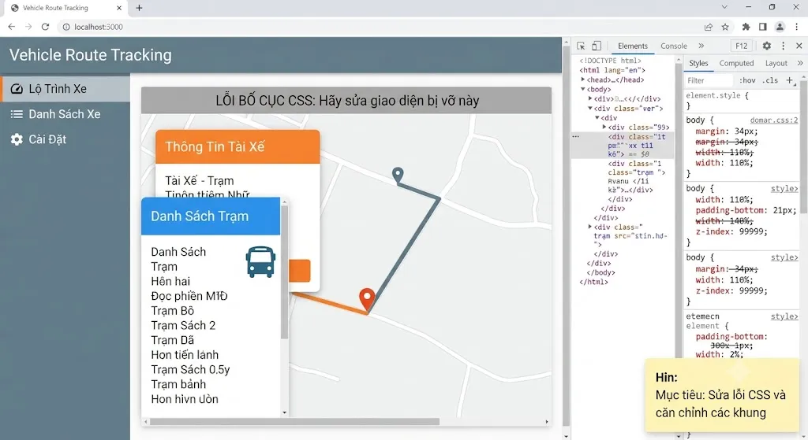
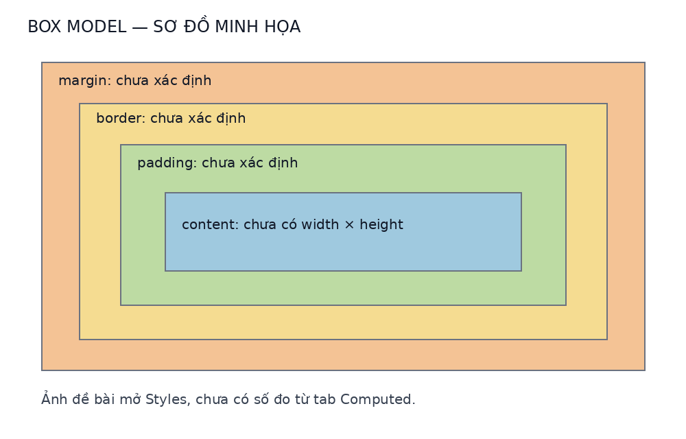

# bài tập box model

họ tên: Huỳnh Chí Thiện — lớp: ptithcm_ks26 — môn: it108

## 1. phân tích



khung danh sách trạm đang chồng lên thông tin tài xế

nhấn F12 → Ctrl + Shift + C → chọn khung lỗi → trong Elements tìm thẻ cha bao cả khung. chọn Computed để xem box model


| lớp | ý nghĩa |
| --- | --- |
| content | nội dung bên trong |
| padding | khoảng cách nội dung tới viền |
| border | viền của khung |
| margin | khoảng cách bên ngoài khung |

ảnh chỉ có Styles nên chưa biết số đo Computed. `body` có `width: 110%` có thể gây tràn ngang. cần kiểm tra thêm kích thước và position của hai khung

## 2. triển khai

chỉ thử trong Styles, ko sửa file nguồn. selector dưới đây là tên minh họa, cần thay bằng selector tìm được khi inspect. `.panels` là vùng chỉ chứa hai khung

```css
body { width: auto; margin: 0; }
.panels {
  display: flex;
  flex-direction: column;
  gap: 16px;
}
.driver-info, .station-list {
  position: static;
  transform: none;
  width: 100%;
  max-width: 320px;
  height: auto;
  margin: 0;
  padding: 12px;
  border: 1px solid #ccc;
  box-sizing: border-box;
}
```

hai khung xếp dọc, cách nhau 16px. `border-box` tính padding và border vào width để hạn chế tràn

## 3. kiểm thử

- nếu đổi margin ko di chuyển: xem dòng bị gạch ngang trong Styles, kiểm tra inline style, `!important` và độ ưu tiên selector
- xem giá trị cuối trong Computed. nếu margin đã áp dụng thì kiểm tra position, transform, thẻ cha và hiện tượng gộp margin
- Browser Engine áp dụng CSS cascade để chọn rule có hiệu lực
- thu nhỏ cửa sổ, cuộn danh sách và kiểm tra hai khung ko che nhau

chưa có web gốc nên đây là đề xuất, chưa kiểm thử thực tế. sơ đồ box model là minh họa, ko phải ảnh Computed

## 4. nộp bài

đưa file này cùng thư mục `images` lên repo `ptithcm_ks26_it108_ss18_ex3` rồi nộp link repo lên Portal
